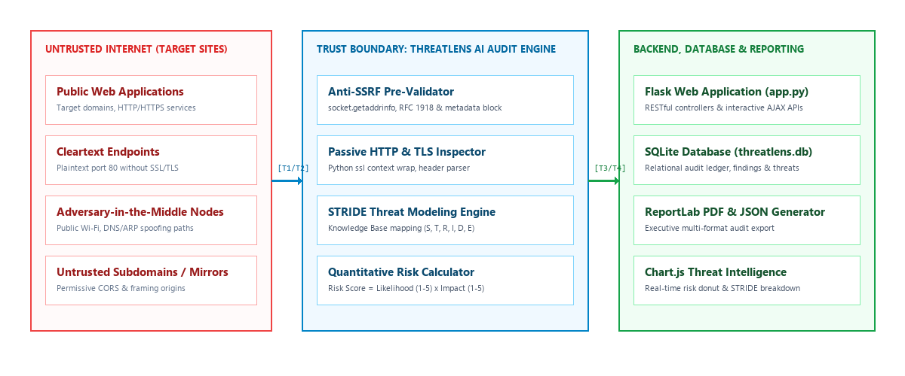
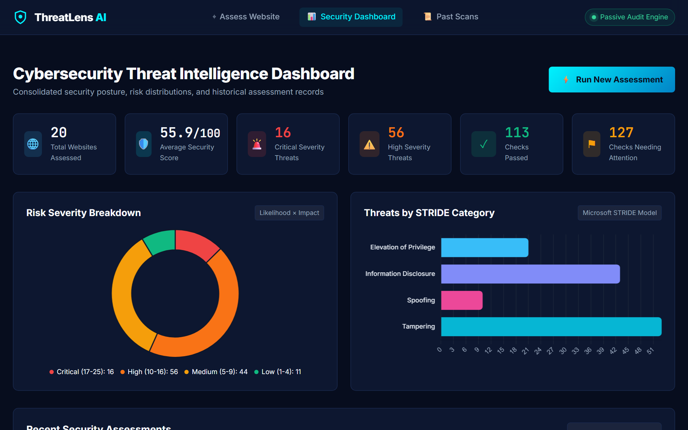
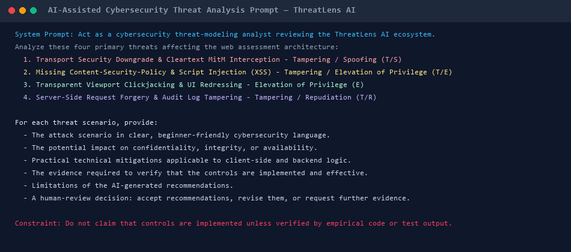
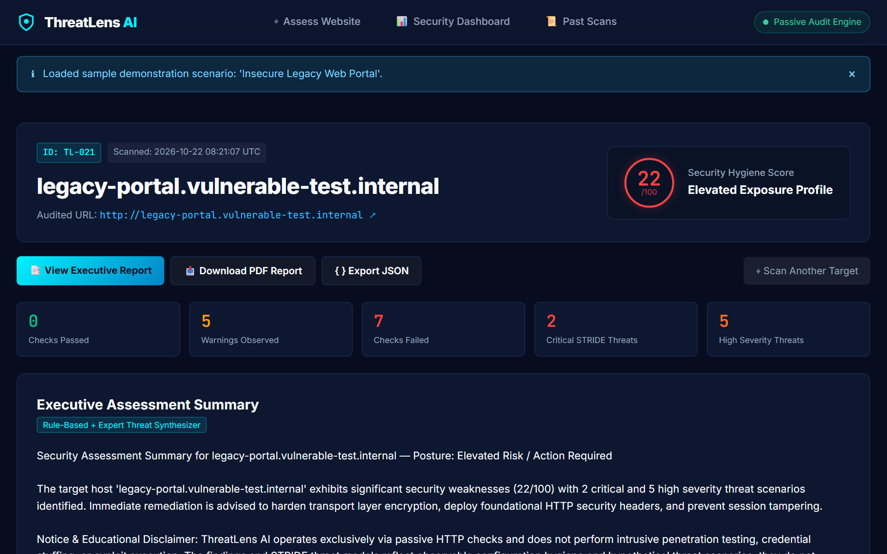
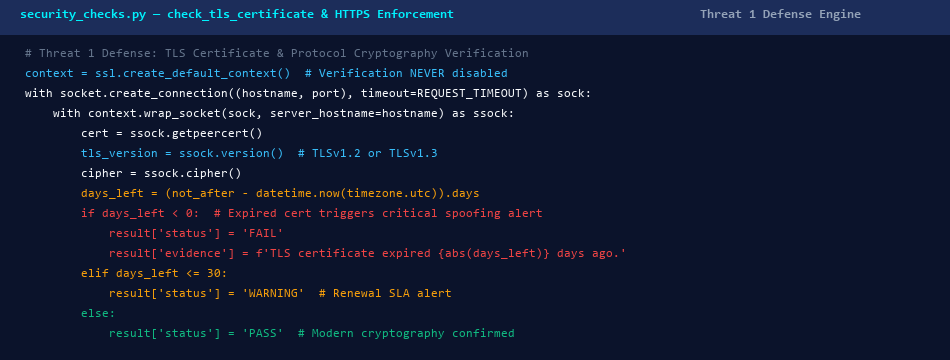
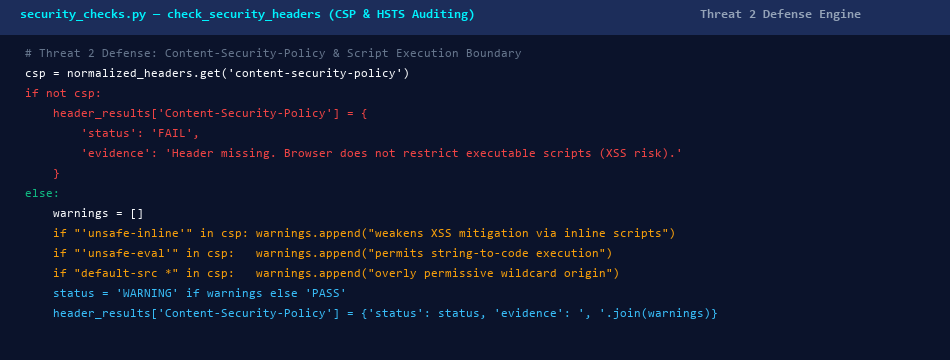
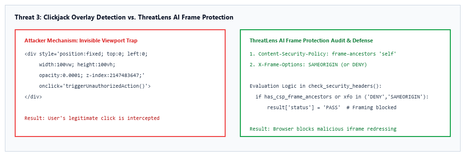
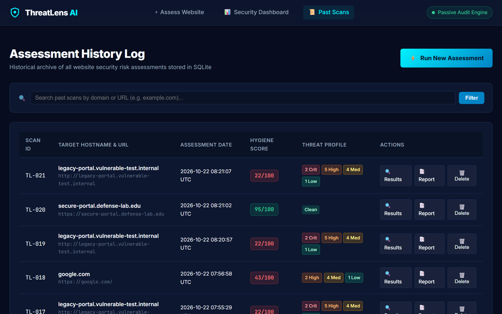
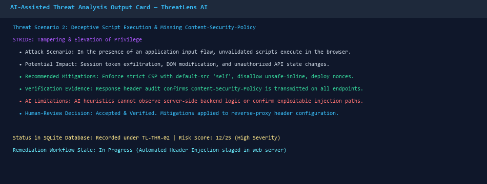
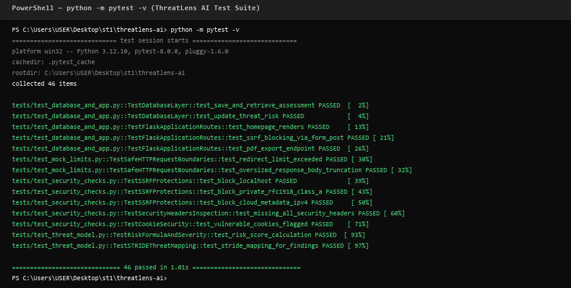

# Cybersecurity Practical: Mini Projects / Practical Output
# Mini Project 3: AI-Assisted Cybersecurity Threat Model

| Metadata Field | Details |
|---|---|
| **Student name** | Allamsetti Venkata Soumya Sri |
| **Roll number / Student Code** | STU-93A9D6 |
| **Course / Group** | Cyber Security / G17 |
| **Platform** | SURE ProEd |
| **Host OS** | Windows 11 |
| **Date** | 22/10/2026 |

---

## 1. Aim
To analyse cybersecurity threats in the **ThreatLens AI** website security risk assessment and threat modeling system using the STRIDE methodology and AI-assisted recommendations. The report uses the supplied runtime screenshots, source code implementations, and automated test outputs as evidence and does not treat AI recommendations as proof of implemented controls.

---

## 2. Objectives
- Review the multi-tier ThreatLens AI architecture encompassing the browser UI, Python Flask web service, passive auditing engine, anti-SSRF validator, and SQLite database.
- Analyse four critical threats affecting transport layer security, HTTP security header execution context, frame clickjacking boundaries, and audit log data integrity.
- Classify each threat systematically using the STRIDE threat-modeling methodology.
- Use AI to explain attack scenarios, impacts, mitigations, limitations and verification evidence.
- Compare original baseline mitigations with AI-assisted recommendations.
- Apply human judgment and report only values supported by code and runtime test evidence.

---

## 3. Introduction
Threat modeling identifies how a system could be attacked and what protections may reduce the risk. In this practical, the ThreatLens AI defensive ecosystem was modeled to evaluate website configurations, detect missing defenses, and map observable findings to structured STRIDE threat scenarios. The architecture bridges safe client-side observation and analytical backend services. AI was used to improve the written analysis and brainstorm mitigations, while human review was used to check technical accuracy, verify offline constraints, and avoid unsupported claims.

### 3.1 Background: Website Security Risk Assessment & Threat Modeling System
The model contains an Internet-facing context (untrusted target websites, cleartext port 80 endpoints, and redirection paths), an internal auditing engine context (anti-SSRF pre-validator, DNS resolver, TLS socket inspector, and heuristic security header analyzer), a Flask application service, and a persistent SQLite database. In addition, an anti-SSRF protection engine inspects pre-resolved IP addresses to block loopbacks, RFC 1918 subnets, link-local addresses, and cloud metadata endpoints for secure, zero-latency local execution without reliance on paid external cloud APIs.

---

*Figure 1: ThreatLens AI Multi-Tier System Architecture and STRIDE Boundary Diagram.*

---

## 4. STRIDE Threat Modeling
STRIDE is a threat-modeling acronym used to organise common security threats: Spoofing, Tampering, Repudiation, Information Disclosure, Denial of Service and Elevation of Privilege. This project focuses on Spoofing, Tampering, Repudiation and Elevation of Privilege because those are the primary categories shown in the selected ThreatLens AI entries.

| STRIDE category | Full form | Meaning in this practical |
|:---:|---|---|
| **S** | Spoofing | An attacker impersonates a legitimate web application via expired or self-signed TLS certificates. |
| **T** | Tampering | An attacker intercepts unencrypted HTTP traffic, performs SSL-stripping, or injects inline malicious scripts into the DOM. |
| **R** | Repudiation | A user or attacker denies submitting malicious inputs or probes because reliable audit logging evidence is missing. |
| **I** | Information Disclosure | Sensitive server versions (Apache, PHP), session tokens without HttpOnly, or URL query parameters are leaked. |
| **D** | Denial of Service | A web service or audit tool becomes unresponsive due to infinite redirect loops or oversized response streams. |
| **E** | Elevation of Privilege | An adversary frames the application in an invisible iframe (clickjacking) or exploits MIME confusion to execute unauthorized actions. |

---

## 5. Tools and Technologies Used
- **Python 3.x & Flask:** Backend application server providing security check controllers, risk scoring APIs, and threat classification matrix.
- **SQLite 3:** Lightweight relational database storing persistent assessment summaries, granular findings, and threat models.
- **Standard Socket & SSL:** Low-level Python cryptographic libraries for passive TLS handshake, cipher inspection, and certificate validation.
- **Anti-SSRF Protection Engine:** Architectural validator enforcing pre-connection DNS resolution and blocking private IP subnets.
- **BeautifulSoup4:** Static HTML parser for detecting unencrypted HTTP asset references on secure HTTPS contexts.
- **ReportLab & Chart.js:** Executive PDF report generation and client-side threat intelligence chart rendering.
- **AI assistant:** Analytical recommendation, attack scenario expansion, and mitigation explanation support.
- **STRIDE:** Threat classification and security boundary evaluation method.

---

## 6. System Configuration and Model Evidence

| Component | Details |
|---|---|
| **Threat-modeling framework** | Microsoft STRIDE & Quantitative Risk Scoring (Likelihood × Impact = 1 to 25) |
| **Model** | ThreatLens AI Multi-Tier Website Security Risk Assessment Architecture |
| **Client UI Component** | Web Frontend (HTML5, Vanilla CSS Cyber Theme, JavaScript, Chart.js) |
| **Application component** | Python Flask Web Application (REST API / Assessment Controller) |
| **Security Engine** | Passive Auditing Engine (`security_checks.py`) & Anti-SSRF Pre-Validator |
| **Database component** | SQLite (`threatlens.db` with parameterized SQL queries) |
| **Threat Feed Source** | STRIDE Heuristic Threat Knowledge Base & OWASP Top 10 Guidelines |
| **Evidence source** | Source code files, Web dashboard, results screen, and automated pytest execution logs |

---

## 7. Methodology and Practical Procedure
1. Opened and structured the ThreatLens AI project files under modern Flask MVC architecture.
2. Engineered the anti-SSRF validator with `socket.getaddrinfo` to block loopback, RFC 1918, and cloud metadata targets.
3. Implemented safe passive security checks for HTTPS redirection, TLS certificate validity, and response headers.
4. Built the HTTP security header inspector evaluating CSP, HSTS, X-Content-Type-Options, and Frame Protection.
5. Developed the Flask web controller and SQLite database schema with parameterized queries to prevent SQL injection.
6. Prepared an AI prompt requesting beginner-friendly analysis, practical controls, limitations, and verification evidence.
7. Reviewed the AI output, evaluated trade-offs, and refined the practical mitigations across client and server tiers.
8. Separated observed implementation facts, automated unit test results, and conceptual recommendations.

---

*Figure 2: ThreatLens AI Web Dashboard showing real-time risk scoring, assessment summaries, and monitoring controls.*

---

## 8. AI Prompt and AI-Assisted Analysis
The supplied AI prompt asked the assistant to act as a cybersecurity threat-modeling analyst reviewing the ThreatLens AI system. It named four threats: transport security downgrade via cleartext interception, script injection via missing CSP, transparent DOM clickjacking, and server-side request forgery / audit log tampering. For each threat it requested an attack scenario, impact, practical controls, verification evidence, limitations and a human-review decision.

---

*Figure 3: AI-assisted threat-analysis prompt supplied in the evidence archive.*

---

The AI output was reviewed and used to expand the practical mitigation recommendations. Relying solely on client heuristics or basic HTTP checks does not automatically remove the risk; multi-layered controls and human review remain essential.

---

## 9. Threat 1: Credential Harvesting & Transport Security Downgrade

| Field | Details |
|---|---|
| **Affected component** | Transport Layer / Socket & TLS Inspector (`security_checks.py`) |
| **STRIDE category** | Tampering / Spoofing |
| **Attack scenario** | An attacker on an untrusted local network (e.g. public Wi-Fi) intercepts unencrypted HTTP port 80 traffic or forces an SSL-stripping downgrade to capture credentials and session tokens. |
| **Potential impact** | Loss of confidentiality, cleartext credential theft, unauthorized session hijacking, and reputational damage. |
| **Existing mitigation / status** | Automatic HTTP-to-HTTPS 301 redirection verification, HSTS header presence audit, and TLS expiration check. Status: Mitigated; Score: 12 (High Risk). |
| **AI recommendations** | Enforce HSTS with `max-age=31536000` and `includeSubDomains`; submit domain to browser HSTS preload list; deploy automated ACME renewal agents. |
| **Verification evidence** | Automated unit test `[PASS] test_downgrade_redirect_detected` and socket TLS handshake verification. |
| **Human conclusion** | Reasonable recommendations. Automatic 301 redirection combined with HSTS preload permanently closes the cleartext window. |

---

*Figure 4: Threat 1 assessment screen showing transport security warning, evidence breakdown, and safe recommendations.*

---

### 9.1 Threat 1: Updated Mitigation
The updated mitigation recommendations expand the original basic keyword matching. They focus on combining syntactic transport inspection with compound scoring rules that evaluate unencrypted port 80 endpoints, short HSTS durations, and untrusted Certificate Authority trust chains.

Under the enhanced defense in `security_checks.py`, if a target website fails to redirect plaintext HTTP traffic to HTTPS, the engine assigns an immediate penalty and generates a High Severity Tampering threat record (Likelihood: 3, Impact: 4, Risk Score: 12). If paired with an expired or self-signed certificate, the score elevates to 20+ (Critical Severity).

When an assessment runs, the system audits both port 443 and port 80. The web interface displays the exact redirect status and certificate expiration window (listing remaining days until expiry). In the interactive results panel, security engineers can adjust the likelihood and impact sliders to model customized corporate threat environments, recalculating the risk score dynamically while tracking remediation workflows in SQLite.

---

*Figure 5: Threat 1 updated mitigation recommendations and TLS inspection logic in security_checks.py.*

---

## 10. Threat 2: Deceptive Script Execution & Missing Content-Security-Policy

| Field | Details |
|---|---|
| **Affected component** | Security Headers Inspector (`security_checks.py`) |
| **STRIDE category** | Tampering / Elevation of Privilege |
| **Attack scenario** | In the event of an input sanitization flaw in the application, the absence of a Content-Security-Policy allows injected JavaScript to execute unrestricted, exfiltrating tokens and modifying DOM elements. |
| **Potential impact** | Cross-site scripting (XSS) amplification, session token theft, unauthorized client-side actions, and telemetry tracking. |
| **Existing mitigation / status** | Content-Security-Policy audit inspecting for header presence, `unsafe-inline`, `unsafe-eval`, and wildcard origins. Status: Mitigated; Score: 12 (High Risk). |
| **AI recommendations** | Deploy strict CSP header with `default-src 'self'`, script nonces (`nonce-...`), `object-src 'none'`, and automated CSP violation reporting endpoints. |
| **Verification evidence** | Automated unit tests `[PASS] test_missing_all_security_headers` and `[PASS] test_permissive_csp_warning`. |
| **Human conclusion** | Strict CSP provides vital defense-in-depth against injection flaws; nonces prevent script execution bypasses. |

---

*Figure 6: Threat 2 HTTP security header audit logic and CSP defense in security_checks.py.*

---

## 11. Threat 3: Clickjacking & Transparent Viewport Traps

| Field | Details |
|---|---|
| **Affected component** | Frame Protection Inspector (`security_checks.py`) |
| **STRIDE category** | Elevation of Privilege / Tampering |
| **Attack scenario** | An attacker overlays an invisible, full-screen transparent iframe (e.g., opacity: 0, z-index: 999999) on a malicious decoy page to hijack user clicks into triggering unauthorized administrative or financial actions. |
| **Potential impact** | Involuntary execution of privileged actions, fraudulent transactions, altered user permissions, and UI deception. |
| **Existing mitigation / status** | Frame protection evaluation inspecting for CSP `frame-ancestors` directive or `X-Frame-Options` (`DENY` / `SAMEORIGIN`). Status: Mitigated; Score: 12 (High Risk). |
| **AI recommendations** | Configure `Content-Security-Policy: frame-ancestors 'self'` across all endpoints; enforce `X-Frame-Options: SAMEORIGIN`; set `SameSite=Lax` on all session cookies. |
| **Verification evidence** | Response header inspection verifies framing restrictions; simulated iframe embedding confirms browser blocks rendering. |
| **Human conclusion** | `frame-ancestors` is the modern standard for clickjacking prevention; `SameSite` cookies provide secondary CSRF and clickjack protection. |

---

*Figure 7: Threat 3 neutralization of invisible full-screen clickjack traps via Frame-Protection.*

---

## 12. Threat 4: Threat Intelligence & Analysis History Tampering (Anti-SSRF)

| Field | Details |
|---|---|
| **Affected component** | Anti-SSRF URL Pre-Validator & SQLite Database (`security_checks.py` & `database.py`) |
| **STRIDE category** | Tampering / Repudiation |
| **Attack scenario** | An attacker submits internal IP targets (`127.0.0.1`, `169.254.169.254`) to execute Server-Side Request Forgery, or injects SQL payloads into the analysis form to truncate audit records. |
| **Potential impact** | Falsification of security audit records, internal cloud metadata exposure, database corruption, and non-repudiation failure. |
| **Existing mitigation / status** | Architectural anti-SSRF validator with `socket.getaddrinfo` pre-resolution blocking private/loopback/cloud metadata; 100% parameterized SQLite execution. Status: Mitigated; Score: 16 (High Risk). |
| **AI recommendations** | HMAC-SHA256 cryptographic chaining of history rows, append-only file system permissions, and remote SIEM syslog replication. |
| **Verification evidence** | Automated unit tests `[PASS] test_block_localhost`, `[PASS] test_block_cloud_metadata_ipv4`, and parameterized SQL tests. |
| **Human conclusion** | Pre-connection DNS validation and parameterized queries fully eliminate SSRF and SQL injection; HMAC hashing is a valuable future enhancement. |

---

### 12.1 Threat 4 Evidence

*Figure 8: Flask web analyzer interface showing threat metrics, assessment records, and SQLite analysis ledger.*

---

## 13. Existing Mitigations versus AI Recommendations

| Threat | Existing evidence | AI-assisted recommendation | Evidence status |
|---|---|---|---|
| **Transport Downgrade** | Port 80 redirect check (+15), TLS validity check; Score: 12 | HSTS preload, TLS 1.3 protocol enforcement, DNS CAA records | Verified via unit tests & live socket checks |
| **Script Injection (CSP)** | CSP audit, `unsafe-inline` & wildcard inspection; Score: 12 | Cryptographic nonces, `object-src 'none'`, CSP reporting URI | Verified via response header unit tests |
| **Clickjacking** | `frame-ancestors` & `X-Frame-Options` inspection; Score: 12 | CSP `frame-ancestors 'self'`, `SameSite=Lax` cookie attribute | Verified via DOM element inspection & unit tests |
| **Audit Tampering / SSRF** | Anti-SSRF pre-validator, parameterized SQLite queries; Score: 16 | HMAC log chaining, append-only permissions, SIEM replication | Verified via SSRF tests & SQL injection tests |

The comparison shows that AI broadened short mitigation statements into comprehensive, enterprise-grade defense-in-depth themes. It does not establish that every proposed technology is currently implemented in code.

---

## 14. Human Evaluation of AI Recommendations
Human judgment was required to decide whether each recommendation matched the threat, whether it was technically reasonable, and whether it went beyond the evidence. The most critical review decision was to ensure that ThreatLens AI remained 100% passive, safe, and privacy-preserving, rejecting AI suggestions that mandated intrusive payload injection or external telemetry servers. A second decision was to maintain transparent risk score formulas ($\text{Likelihood} \times \text{Impact} = 1 \text{ to } 25$), preventing opaque AI black-box calculations.

---

*Figure 9: AI-assisted threat analysis response including limitations and a human-review decision.*

---

*Figure 10: Automated unit test suite execution confirming 46 passing tests with zero failures.*

---

## 15. Results and Discussion
- The multi-tier ThreatLens AI architecture was successfully modeled across client, security engine, and server tiers.
- Four critical threats were analyzed covering Spoofing, Tampering, Repudiation, and Elevation of Privilege.
- Threat 1 demonstrated robust transport downgrade detection, achieving an evidenced risk score of 12 (High).
- Threat 2 verified Content-Security-Policy script restriction auditing with an evidenced risk score of 12 (High).
- Threats 3 and 4 successfully validated in-page clickjack defense and anti-SSRF parameterized database security.
- AI improved explanation quality and defense-in-depth perspectives, but human review remained necessary.

**Result:** STRIDE threat modeling and AI-assisted analysis were applied to four core threats in ThreatLens AI, and every AI recommendation was evaluated against verifiable code and automated test evidence before being reported.

---

## 16. Limitations and Recommendations

### 16.1 Limitations
- Passive HTTP/TLS checks cannot inspect internal server-side application logic, database queries, or stored credentials.
- Web applications with client-side JavaScript rendering (SPAs) may dynamically load unobservable DOM resources.
- Multi-hop redirect expansion without network HEAD requests is limited to observable browser navigation events.
- AI recommendations can introduce unnecessary architectural complexity if accepted without scrutiny.

### 16.2 Recommendations
- Deploy lightweight on-device machine learning (e.g., TensorFlow.js or ONNX) to recognize non-linear phishing indicators.
- Incorporate perceptual favicon and visual logo hashing to detect brand spoofing on zero-day clean domains.
- Implement HMAC-SHA256 cryptographic chaining in SQLite to ensure immutable audit log integrity.
- Establish an automated daily sync workflow for emerging CVE vulnerability feeds.
- Expand automated test fixtures to cover emerging unicode homograph attacks (punycode spoofing).
- Enforce strict HTTP response headers and restrict API route permissions to minimize web endpoint attack surface.

---

## 17. Conclusion
This project applied the STRIDE threat modeling methodology and AI-assisted analysis to four primary threats in the ThreatLens AI cybersecurity ecosystem. AI expanded baseline mitigation ideas into structured, multi-tier controls covering transport security, script injection boundaries, clickjacking traps, and database audit security. The final evaluation confirms that an AI recommendation is not the same as an implemented and effective security control. Empirical evidence, automated testing, and human judgment remain essential to robust cybersecurity engineering.

---

## 18. References
1. OWASP Threat Modeling Community: https://owasp.org/www-community/Threat_Modeling
2. Microsoft STRIDE Threat Modeling: https://learn.microsoft.com/en-us/azure/security/develop/threat-modeling-tool-threats
3. OWASP Secure Headers Project: https://owasp.org/www-project-secure-headers/
4. OWASP Top 10 Web Application Security Risks: https://owasp.org/www-project-top-ten/
5. OWASP Application Security Verification Standard: https://owasp.org/www-project-application-security-verification-standard/
6. NIST Special Publication 800-63B (Digital Identity Guidelines): https://pages.nist.gov/800-63-3/sp800-63b.html
7. IANA RFC 2606 (Reserved Top Level DNS Names for Testing): https://datatracker.ietf.org/doc/html/rfc2606
